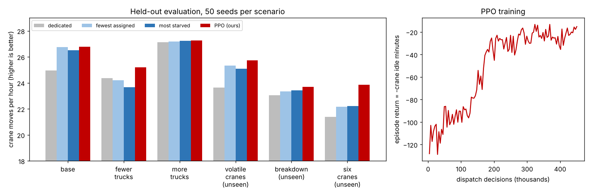
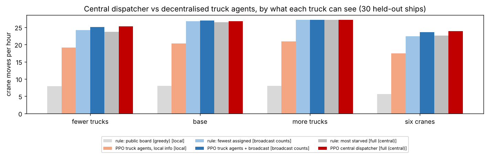

# Container Terminal RL: PPO for Truck Dispatch at a Port

[](https://github.com/f20220970-debug/container-terminal-rl/actions/workflows/tests.yml)

Built for **DP World Group AI/ML's PS-II Project 1** (*container terminal optimisation and reinforcement
learning*). It turns one real terminal decision into a measurable RL problem, writes PPO from scratch in
PyTorch, and compares the learned policy with the dispatching rules terminals use, on held-out runs and
stress tests it never trained on.

> **Synthetic simulator.** Crane cycle times, distances and yard service times are plausible assumptions
> (in [`terminal_rl/env.py`](terminal_rl/env.py)), not data from any terminal. No proprietary information
> is used.



## The problem
A vessel is unloaded by **quay cranes**. Each crane lifts a box off the ship and must hand it to an
**internal truck**. If no truck is waiting, the crane stops, and a stopped crane is the most expensive idle
asset in a terminal. Trucks carry each box to a **yard block**, queue for the yard crane, unload, and need
a new job.

**Decision:** every time a truck becomes empty, which quay crane should it drive to next?
**KPI:** crane moves per hour (gross crane productivity), which sets vessel turnaround.

| Piece | How it is set up |
| --- | --- |
| Environment | Gymnasium, event-driven (semi-Markov): one step = one dispatch decision, simulated time jumps between decisions |
| State | per crane: work left, idle now, time until it next needs a truck, trucks already assigned, slack before its next truck arrives, this truck's travel time and lateness; plus 3 global features |
| Action | which crane (invalid cranes masked) |
| Reward | minus the crane idle minutes since the last decision, so the episode return = minus total crane idle |
| Default terminal | 4 quay cranes, 10 trucks, 6 yard blocks, 240 boxes per vessel |

## The agent
- **PPO written from scratch** (`terminal_rl/ppo.py`, no RL library): clipped objective, GAE (λ = 0.95),
  value loss, entropy bonus, gradient clipping and action masking.
- **One shared network scores every crane** from that crane's features, so the policy does not depend on
  the number of cranes. It trains on 4 cranes and runs on 6 without retraining.
- **Domain randomisation:** each training episode draws a fleet of 8–14 trucks and crane-cycle
  variability of 0.25–0.5. Trained for 450K decisions (~11 minutes on 2 CPU cores).

## Baselines (common terminal rules)
| Rule | What it does |
| --- | --- |
| nearest | send the truck to the closest crane |
| dedicated | "gang" practice: each truck is tied to one crane |
| fewest assigned | crane with the fewest trucks heading to it |
| most starved | crane that will otherwise wait longest for its next truck |
| random | sanity floor |

## Results: 50 held-out seeds per scenario
| Scenario | Seen in training? | Best rule | Best rule (moves/h) | PPO (moves/h) | PPO − best rule (95% CI) | PPO wins |
| --- | --- | --- | --- | --- | --- | --- |
| Base (10 trucks) | yes | fewest assigned | 26.75 | **26.77** | +0.03 (−0.17, 0.22) | 46% |
| Fewer trucks (8) | yes | dedicated | 24.38 | **25.19** | **+0.81 (0.62, 0.98)** | 86% |
| More trucks (14) | yes | most starved | 27.23 | **27.26** | +0.03 (−0.08, 0.14) | 26% |
| Volatile cranes (cv 0.6) | **no** | fewest assigned | 25.33 | **25.73** | +0.40 (−0.01, 0.79) | 66% |
| Crane breakdown (25 min) | **no** | most starved | 23.42 | **23.69** | +0.27 (0.05, 0.48) | 64% |
| 6 cranes, 15 trucks | **no** | most starved | 22.21 | **23.85** | **+1.65 (1.21, 2.07)** | 86% |

CI = bootstrap 95% interval of the paired per-seed difference (same seed = same ship and same random
draws for every policy).

**What this shows**
1. **No single rule is best everywhere.** The best rule changes with the scenario (dedicated, fewest
   assigned or most starved). PPO matches or beats the best rule in every scenario, without being told
   which scenario it is in.
2. **The gains come where trucks are scarce:** +0.81 moves/h with 8 trucks, and +1.65 (+7.4%) on a
   6-crane quay it never saw, cutting vessel turnaround from 2.71 h to 2.52 h.
3. **When trucks are plentiful, it's a tie.** With 14 trucks every good rule sits near the physical limit
   (~28.8 moves/h), so there is nothing left to learn. That's a useful finding: RL is worth deploying for
   scarce-fleet shifts, not all shifts.
4. **Myopic rules fail badly.** "Nearest crane" starves the far cranes: 26% crane idle time and half the
   productivity.

## Error analysis
- **Reward vs KPI mismatch (found in evaluation).** On the 6-crane quay, PPO's crane idle % (11.9%) is
  about the same as the rules' (11.7–12.6%), yet turnaround is 7% faster (2.52 h vs 2.71 h). The gain comes from **balancing
  work so all cranes finish together**: vessel turnaround is set by the slowest crane, which the per-step
  idle reward does not measure directly. This led to the follow-up below.
- **Volatile cranes:** the improvement on seed 0 (+0.40) is borderline (CI just touches 0); across 3 training
  seeds all three beat the best rule, by +0.2 on average.
- **Where PPO loses on individual ships:** in the base and 14-truck cases it loses about half the paired
  comparisons by small margins. These are ties within noise, not systematic failures.

## Follow-up 1: 3 training seeds, and a reward that also counts turnaround
Six PPO runs: 3 seeds with the idle-time reward, and 3 with idle time plus an end-of-episode penalty on
turnaround above a lower bound (`makespan_coef = 0.5`). Each is evaluated on the same 30 held-out ships per scenario.

| Scenario | Best rule | Idle reward: mean of 3 seeds (range) | Seeds beating rule | Idle + turnaround: mean (range) | Seeds beating rule |
| --- | --- | --- | --- | --- | --- |
| Base | 26.75 | 26.82 (26.73–26.98) | 2/3 | 26.77 (26.69–26.85) | 2/3 |
| Fewer trucks | 24.39 | 25.10 (24.87–25.25) | **3/3** | **25.22** (25.14–25.36) | **3/3** |
| More trucks | 27.18 | 27.16 (27.14–27.18) | tie | 27.16 | tie |
| Volatile cranes (unseen) | 25.28 | 25.50 (25.40–25.60) | **3/3** | 25.49 (25.35–25.68) | **3/3** |
| Crane breakdown (unseen) | 23.47 | 23.45 (23.18–23.60) | 2/3 | **23.55** (23.48–23.64) | **3/3** |
| 6 cranes (unseen) | 22.58 | 23.72 (23.38–23.91) | **3/3** | **23.93** (23.79–24.10) | **3/3** |

*Crane moves per hour.*

- **The main result holds across seeds:** every training seed beats the best rule with scarce trucks, with
  volatile cranes and on the unseen 6-crane quay. The seed-0 breakdown gain (+0.27) was partly luck: with the
  idle reward, the 3-seed average is a tie.
- **Adding turnaround to the reward helps exactly where balancing matters.** On the 6-crane quay, turnaround
  falls from 2.53 h to 2.51 h; breakdowns move from a tie to all 3 seeds ahead. Elsewhere nothing changes. So the
  error analysis was right about the cause.

## Follow-up 2: multi-agent, a central brain vs truck-level agents
Each truck becomes its own agent with a shared policy (parameter sharing, independent-PPO style). Three
levels of what a truck can see:
- **local:** a public crane board (idle now, next ready time) plus its own travel times
- **broadcast:** local, plus how many trucks have announced each crane as their destination
- **full:** the central dispatcher's view, including every truck's arrival time



| What trucks can see | Policy | Fewer trucks | Base | More trucks | 6 cranes |
| --- | --- | --- | --- | --- | --- |
| Local | greedy rule ("public board") | 7.9 | 8.0 | 8.0 | 5.6 |
| Local | PPO truck agents | 19.2 | 20.3 | 20.9 | 17.4 |
| Broadcast | rule (fewest assigned) | 24.2 | 26.8 | 27.1 | 22.5 |
| Broadcast | **PPO truck agents** | 25.1 | **26.9** | 27.2 | 23.6 |
| Full | **PPO central dispatcher** | **25.3** | 26.8 | 27.2 | **23.9** |

- **Without communication, decentralised trucks herd.** With only the public board, the greedy rule sends
  many trucks to the same "soon ready" crane at once and productivity collapses (8 moves/h). Learned agents
  avoid the worst of it but only reach random-dispatch level (~20).
- **One small broadcast fixes coordination.** If each truck just announces which crane it's heading to, the
  learned truck agents reach 99–101% of the central dispatcher. That's a practical design point: truck-level
  autonomy needs a shared intent channel, not a full central brain.

## Follow-up 3: throughput and reproducibility
- **Simulator speed:** about 11,700 dispatch decisions per second on one core. With 2 parallel worker processes
  it's 21,100 per second (1.81× speedup, 91% efficiency; `bench.py`, `results/benchmark.json`). The test machine
  has 2 cores; the actor-learner version is in [distributed-rl-rollouts](https://github.com/f20220970-debug/distributed-rl-rollouts).
- **Docker:** `docker build -t terminal-rl . && docker run --rm terminal-rl` runs the tests, the evaluation, the
  plots and the benchmark.

## Run it
```bash
pip install -r requirements.txt
python train.py               # ~11 min on CPU, saves results/ppo_dispatcher.pt (trained models are included)
python evaluate.py            # ~1 min: 6 scenarios x 50 seeds x 6 policies -> results/
python train_seeds.py 1 0     # extra seeds; second argument = turnaround coefficient (0 or 0.5)
python evaluate_seeds.py      # 3 seeds x 2 rewards -> results/seed_summary.csv
python train_ma.py comm 0     # multi-agent runs: local | comm
python multiagent_eval.py     # -> results/multiagent_summary.csv
python bench.py               # throughput with 1..N worker processes
python plot.py                # docs/*.png
pytest -q                     # 5 checks: every box delivered, return = -idle time, determinism, physical limit, masking
```

## Limitations and next steps
- A single vessel and a simplified yard (no stacking or yard-crane scheduling). Next: joint quay-crane and
  yard-crane decisions.
- Multi-agent agents act one at a time, as each truck becomes free. Truly simultaneous decisions would need a
  centralised-critic method (MAPPO-style) for a fair test.
- The simulator is not calibrated to a real terminal. With operational logs, step one would be fitting
  cycle-time and travel-time distributions and checking that the simulator reproduces historical moves
  per hour before trusting any policy.

## Why it matters for DP World
DP World runs about 110M TEU of terminal capacity, roughly 10% of world container traffic (investor
presentation, November 2026). At that scale, a fraction of a crane move per hour per crane is worth a
great deal, and the scarce-fleet shifts (breakdowns, peaks) are exactly where this project found the gains.

Built by Pavitra Seth (BITS Pilani) as preparation for DP World's PS-II. Not affiliated with DP World.
